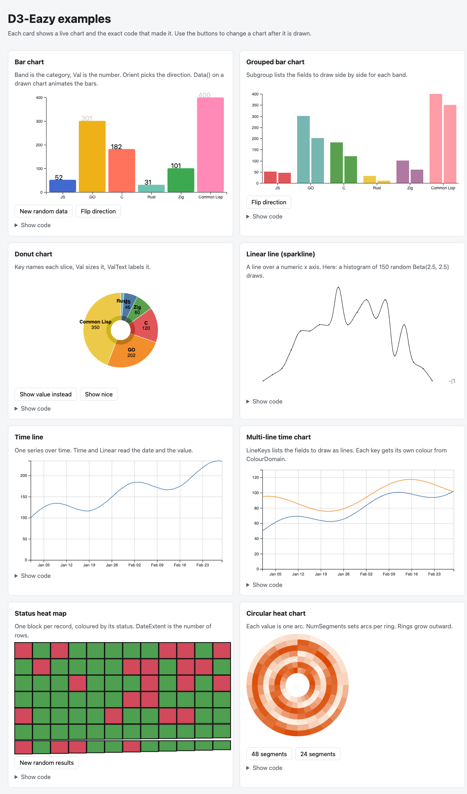

# D3-Eazy



> **Status: alpha.** The API can change. Pin the version you use.

D3-Eazy is a set of ready-made [D3](https://d3js.org) charts. Each chart follows the
[reusable chart pattern](https://bost.ocks.org/mike/chart/) from Mike Bostock.
You configure a chart with chained setters, then draw it with `selection.call(chart)`.
You can change a setter later and the chart redraws. You still have the full D3 API.

## Install

```sh
npm install d3-eazy d3
```

D3-Eazy is an ES module. It needs `d3` v7 and `luxon` v3 (`luxon` installs with the package).
There is no build step for the library. Use any bundler that handles ES modules, such as esbuild or Vite.

## Quick start

```html
<div id="bars" style="height: 300px"></div>
```

```javascript
import * as d3 from "d3";
import { BarChartSimple } from "d3-eazy";

const data = [
  { name: "JS", value: 52 },
  { name: "GO", value: 301 },
  { name: "Rust", value: 31 },
];
const names = data.map((d) => d.name);
const { width, height } = document.getElementById("bars").getBoundingClientRect();

const bars = BarChartSimple()
  .SvgID("bars-svg")
  .Title("Language scores") // accessible name, see "Accessibility"
  .Band((d) => d.name) // which field is the category
  .Val((d) => d.value) // which field is the number
  .DomainBand(names)
  .DomainVal([0, d3.max(data, (d) => d.value)])
  .ColourDomain(names)
  .ColourRange(d3.schemeObservable10)
  .Orient("horizontal")
  .Width(width)
  .Height(height)
  .MarginLeft(40)
  .MarginBottom(24)
  .Data(data);

d3.select("#bars").call(bars);
```

Run the full demo: `npm install && npm run build`, then open `index.html`
(or serve the folder, for example `python3 -m http.server`).
Each card on that page shows its own source code.

## How it works

**Setters and getters.** Every option is one method. Call it with a value to set it.
The method returns the chart, so calls chain. Call it with no argument to read the value.

```javascript
bars.Orient("vertical"); // set
bars.Orient(); // "vertical"
```

**Draw.** Call the chart on a D3 selection. The chart adds one `<svg>` to each selected element.

```javascript
d3.select("#bars").call(bars);
```

**Update.** After the first draw, change any setter. The chart updates itself.
`BarChartSimple.Data()` and `DonutChartSimple.Data()` animate to the new data.
For every other setter and chart, the chart removes its `<svg>` and draws it again.
Several setter calls in a row cause one redraw.

```javascript
bars.Data(newRows).Orient("vertical"); // one update
```

**Size.** A chart does not measure its container. Pass `Width()` and `Height()`.
The `<svg>` gets a `viewBox` and scales down with its container when the window resizes.

**One chart, one instance.** Each chart call, such as `BarChartSimple()`, creates a new chart with its own state.
Two charts on one page do not share data.

## Charts

All charts have `SvgID`, `Title`, `Description`, `Data`, `Width`, `Height`, and `MarginTop/Right/Bottom/Left`,
unless the table says otherwise. Read the example in `js/example.jsx` for a working setup of each.

| Chart | Use it for | Main setters |
| --- | --- | --- |
| `BarChartSimple` | Compare values per category | `Band`, `Val`, `DomainBand`, `DomainVal`, `Orient`, `ColourDomain`, `ColourRange`, `WithText`, `CornerRadiusX`, `BarPadding` |
| `GroupedBarChartSimple` | Compare several fields per category | `Band` (array of categories), `Subgroup` (array of field names), `DomainVal`, `Orient`, `ColourDomain` |
| `DonutChartSimple` | Show parts of a whole | `Key`, `Val`, `ValText`, `CenterText`, `InnerRadiusArc`, `OuterRadiusArc`, `ColourDomain` |
| `LineLinearSpark` | One line over a number axis | `LinearAccessor`, `ValAccessor`, `DomainLinear`, `DomainVal`, `Curve`, `WithHover` |
| `LineTimeChartSimple` | One line over time | `Time`, `Linear`, `DomainTime`, `DomainLinear`, `StrokeColour`, `StrokeWidth` |
| `MultiLineTimeChartSimple` | Several lines over time | `Time`, `LineKeys`, `DomainTime`, `DomainVal`, `ColourDomain`, `WithLegend` |
| `HeatMapBlockedSimple` | One block per record, coloured by `status` | `DateAccessor`, `DateExtent`, `ColourDomainZ`, `ColourRangeZ`, `DataAccessor`, `WithHover` |
| `CircularHeatChartSimple` | Cyclic data, such as hours of the day | `NumSegments`, `InnerRadius`, `SegmentHeight`, `ColourRange`, `DataAccessor`, `RadialLabels`, `SegmentLabels` |
| `SingleHorzBarChart` | One stacked bar | `DomainVal`, `ColourDomain`, `WithText`, `WithHover` |
| `LineAndBarChartSimple` | Bars with a line over them | `BandDomain`, `ValDomain`, `ThresholdBin`, `StrokeColour` |

Chart data shapes:

- `BarChartSimple`, `DonutChartSimple`: an array of objects. Accessors pick the fields.
- `GroupedBarChartSimple`: an array of objects. `Subgroup` names the fields to compare.
- `LineLinearSpark`, `LineTimeChartSimple`: an array of objects. Accessors pick x and y.
- `MultiLineTimeChartSimple`: an array like `[{ day: Date, north: 1, south: 2 }]`. `LineKeys(["north", "south"])` picks the lines.
- `HeatMapBlockedSimple`: an array like `[{ date: Date, status: "pass" }]`. The cell colour comes from `status`.
- `CircularHeatChartSimple`: an array of numbers (or objects with `DataAccessor`). Item `i` goes to ring `floor(i / NumSegments)`.

`SingleHorzBarChart` and `LineAndBarChartSimple` have the least testing. Treat them as unstable.

## Accessibility

Call `Title("...")` and `Description("...")` on a chart. The `<svg>` then gets `role="img"`,
a `<title>`, a `<desc>`, and `aria-labelledby`. This follows the
[WAI-ARIA graphics approach](https://www.w3.org/TR/graphics-aria-1.0/).
Without `Title` and `Description`, the chart adds no ARIA markup.

Do not use colour as the only way to show a difference. Add labels as well.
Choose palettes that work for colour-blind readers. `d3.schemeObservable10` and `d3.schemeTableau10` are
reasonable defaults. Avoid red and green as the only difference between two series.

## Development

```sh
npm install
npm run lint     # eslint, catches undeclared variables
npm test         # node:test with jsdom, one render test per chart
npm run build    # bundles js/example.jsx to js/main.js for index.html
npm run check    # all three
```

Project layout:

| Path | Content |
| --- | --- |
| `d3-eazy.js` | Public entry point. Exports every chart. |
| `charts.js` | The chart implementations. |
| `events.js` | Small DOM event helpers (`ready`, `addEventListener`). |
| `js/example.jsx` | Source of the demo page. |
| `tests/` | Tests and the jsdom helper. |

When you add a chart, follow the pattern in `charts.js`: keep all state inside the chart function,
add a getter/setter for each option, call `redraw_.mount(selection)` at the start of the draw function,
and add a test configuration in `tests/charts.test.js`.
The test file fails if an exported chart has no configuration.

## Known limits

- Charts are not tested in a real browser by the test suite. The suite uses jsdom, which has no layout engine.
  Check the demo page after a change.
- Most charts redraw instead of animating when you change a setter.
- `HeatMapBlockedSimple` reads the `status` field of each record. Use `ColourFnZ` for a custom colour function.

## Credits

Mike Bostock for [Towards Reusable Charts](https://bost.ocks.org/mike/chart/).

Rob Moore at Toptal for [Updatable Charts](https://www.toptal.com/d3-js/towards-reusable-d3-js-charts).

## Prior art

[D3-ez](https://github.com/jamesleesaunders/d3-ez). James Lee Saunders' use of events and generalized data format functions was a useful example.

[D3-Timeseries](https://github.com/mcaule/d3-timeseries) by mcaule.

## License

BSD-2-Clause.
